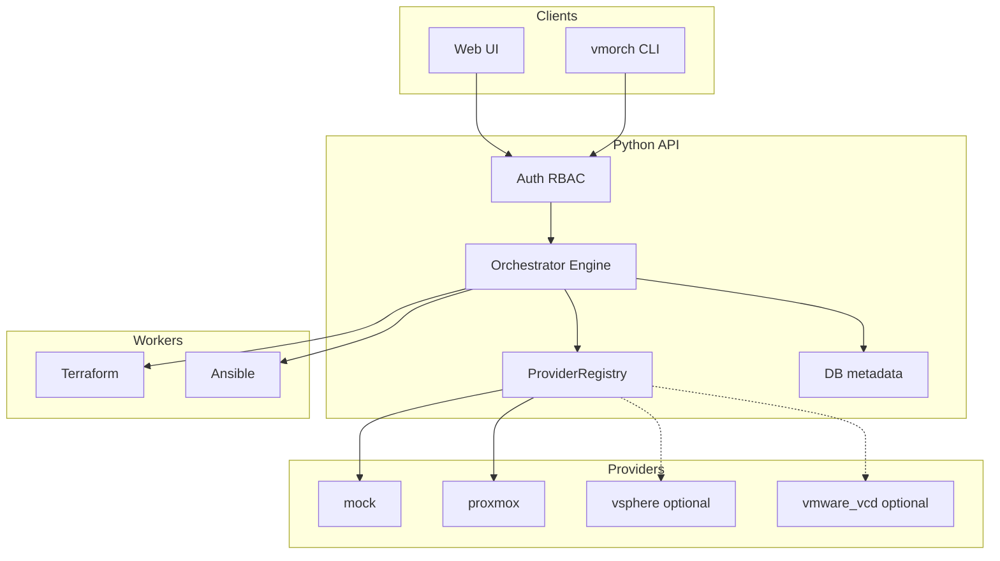

# VM Orchestrator — общий план

Платформа самообслуживания для заказа виртуальных машин: пользователь выбирает профиль и получает готовую ВМ; администратор управляет всеми машинами и видит дашборд свободных ресурсов.

**Целевой гипервизор:** [Proxmox VE](https://www.proxmox.com/) (бесплатный, open source).  
**Расширяемость:** интерфейс `CloudProvider` позволяет позже добавить vSphere, VMware Cloud и другие backend без переписывания API/UI.

## Стек

| Слой | Инструмент | Назначение |
|------|------------|------------|
| API, UI, RBAC | Python (FastAPI) | Авторизация, каталог, квоты, оркестрация |
| Инфраструктура | Terraform | Clone ВМ, ресурсы, сеть, cloud-init, destroy |
| Конфигурация | Ansible | Установка приложений (stacks), cleanup при сдаче |
| CLI | `vmorch` (Typer) | Клиент API для автоматизации |

## Ключевые концепции

| Концепция | Описание |
|-----------|----------|
| **Profile** | Готовый «заказ»: ОС + размер + приложения |
| **Flavor** | vCPU, RAM, диск |
| **Image** | Шаблон/QEMU image в Proxmox (VMID или имя) |
| **Stack** | Набор Ansible-ролей поверх image |
| **Manifest** | YAML-файл экземпляра (`instances/*.yaml`) |
| **Instance** | Конкретная ВМ: `creating → ready → releasing → released` |

## Декларативное описание

**Профиль** (`profiles/dev-docker.yaml`):

```yaml
name: dev-docker
provider: proxmox        # mock | proxmox | vsphere | vmware_vcd
image: "9000"            # VMID шаблона в Proxmox (или имя)
flavor: medium
network: vmbr0
stack:
  - docker
  - git
allowed_for_users: true
```

**Манифест экземпляра** (`instances/myvm.yaml`):

```yaml
name: myvm
profile: dev-docker
ttl: 7d
owner: alice
labels:
  project: backend
```

## Роли (RBAC)

| Действие | User | Admin |
|----------|------|-------|
| Заказать ВМ | да (разрешённые profiles) | да |
| Список ВМ | только свои | все |
| Сдать ВМ | только свои | любые |
| Дашборд ресурсов | нет | да |
| Каталог, квоты, reconcile | нет | да |

## Провайдеры

```text
CloudProvider (интерфейс) — регистрация в providers/registry.py
├── mock         — фазы 0–3, без внешних сервисов
├── proxmox      — целевой backend (фаза 4) ★
├── vsphere      — опционально, см. extensions/vsphere.md
└── vmware_vcd   — опционально, см. extensions/vmware-vcd.md
```

Добавление нового провайдера = новый TF module + класс-обёртка + запись в registry. API, UI, квоты, TTL **не меняются**.

## Архитектура



## Поток заказа

1. User → `POST /instances`
2. API: RBAC + квоты
3. Engine: resolve profile → `registry.get(provider)` → render TF → `apply`
4. Ansible: `configure.yml` (cloud-init + SSH на гостевой ОС)
5. Status → `ready`, IP в БД

## Поток сдачи

1. `POST /instances/{name}/release`
2. Ansible: `cleanup.yml`
3. Terraform: destroy (удаление VM в Proxmox)
4. Status → `released`, audit log

## Оценка сложности

| Фаза | Содержание | Чел·часы | С Grok Build |
|------|------------|----------|--------------|
| 0 | Mock MVP | 40–50 | 20–28 |
| 1 | БД + API + RBAC | 60–80 | 35–50 |
| 2 | Engine + TF/Ansible (mock) | 50–70 | 30–45 |
| 3 | Web UI | 80–100 | 45–65 |
| 4 | **Proxmox VE** | 50–70 | 35–50 |
| 5 | Production hardening | 40–60 | 25–40 |
| **Итого (MVP)** | | **320–430** | **190–278** |

**Опциональные расширения** (не входят в MVP):

| Расширение | Чел·часы |
|------------|----------|
| vSphere | 60–80 |
| VMware Cloud Director | 50–70 |

Буфер +15% на интеграцию с реальным Proxmox-кластером.

**Минимальный демо (фазы 0–1):** ~100–130 ч (~55–75 ч с Grok Build).

## Фазы и пособия

| Фаза | Документ | Результат |
|------|----------|-----------|
| 0 | [phase-0-mock.md](phases/phase-0-mock.md) | CLI, mock provider, SQLite |
| 1 | [phase-1-api-rbac.md](phases/phase-1-api-rbac.md) | FastAPI, JWT, user/admin |
| 2 | [phase-2-engine.md](phases/phase-2-engine.md) | TF renderer, Ansible pipeline |
| 3 | [phase-3-webui.md](phases/phase-3-webui.md) | Единый Web UI |
| 4 | [phase-4-proxmox.md](phases/phase-4-proxmox.md) | Реальный Proxmox VE |
| 5 | [phase-5-hardening.md](phases/phase-5-hardening.md) | CI, тесты, production |
| — | [extensions/vsphere.md](phases/extensions/vsphere.md) | Опционально: vCenter |
| — | [extensions/vmware-vcd.md](phases/extensions/vmware-vcd.md) | Опционально: VCD |

## Целевая структура репозитория

```text
vm_orchestrator/
├── docs/
├── vmorch/
│   ├── api/
│   ├── cli/
│   ├── core/
│   ├── db/
│   ├── providers/
│   │   ├── base.py
│   │   ├── registry.py      # mock | proxmox | vsphere | ...
│   │   ├── mock.py
│   │   └── proxmox.py
│   └── runners/
├── web/
├── terraform/
│   ├── modules/
│   │   ├── mock-vm/
│   │   ├── proxmox-vm/      # целевой module
│   │   ├── vsphere-vm/      # опционально
│   │   └── vcd-vm/          # опционально
│   └── generated/
├── ansible/
├── profiles/
├── instances/
├── config.yaml
└── pyproject.toml
```

## Порядок реализации

1. **Сейчас:** фаза 0 — mock, без Proxmox и Terraform.
2. **Далее:** фазы 1–3 — API, engine, Web UI на mock.
3. **Когда будет Proxmox:** фаза 4 — `provider: proxmox` в profiles.
4. **Потом:** фаза 5 — production.
5. **По необходимости:** extensions/vsphere, extensions/vmware-vcd.

## Чеклист готовности к Proxmox (фаза 4)

- [ ] Proxmox VE установлен (один узел достаточно для dev)
- [ ] API token или user/password с правами VM.Administrator
- [ ] QEMU-шаблон (cloud-init, SSH) — VMID записан в profile
- [ ] Bridge `vmbr0` (или иной) с DHCP
- [ ] Storage (local-lvm / ZFS) с достаточным местом
- [ ] SSH-ключ оркестратора для Ansible

## Почему Proxmox вместо vSphere

| | Proxmox | vSphere |
|--|---------|---------|
| Лицензия | Бесплатно (open source) | Платная подписка |
| API | REST + Terraform `bpg/proxmox` | vCenter + `vmware/vsphere` |
| cloud-init | Native (`cicustom`, `ipconfig0`) | guestinfo / customization spec |
| Homelab / dev | Идеально | Trial 60 дней |
| Корп. DC | Возможно | Традиционный стандарт |

Интерфейс провайдеров позволяет подключить vSphere позже для production DC без смены пользовательского опыта.